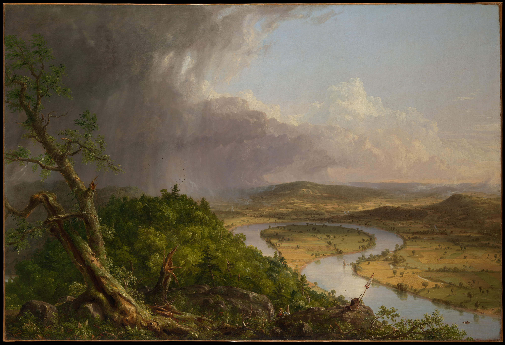

# 每日信息输入

## AI 前沿

本栏为阶段三功能演示，除馆藏作品外，文章均为本项目构造样文。

### 一次作者交稿怎样出版

体裁：讲解综述

来源说明：本项目《阶段三构建记录》，2026-11-06；构造功能示例，不作为新闻事实。

作者只提交正文、期次信息与随期原图。程序保留交稿原件，生成带身份标记的工作副本，再由出版模板安排正文和来源。

### 同栏的第二篇

体裁：讲解综述

来源说明：本项目《阶段三构建记录》，2026-11-06；构造功能示例，不作为新闻事实。

作者只提交正文、期次信息与随期原图。程序保留交稿原件，生成带身份标记的工作副本，再由出版模板安排正文和来源。

## 硬件、图形技术与价格

本栏为阶段三功能演示，除馆藏作品外，文章均为本项目构造样文。

### 把图像长边限制在1600像素

体裁：讲解综述

来源说明：本项目《阶段三构建记录》，2026-11-06；构造功能示例，不作为新闻事实。

作者只提交正文、期次信息与随期原图。程序保留交稿原件，生成带身份标记的工作副本，再由出版模板安排正文和来源。

## 科技与游戏事件

本栏为阶段三功能演示，除馆藏作品外，文章均为本项目构造样文。

### 新闻层也容纳讲解

体裁：讲解综述

来源说明：本项目《阶段三构建记录》，2026-11-06；构造功能示例，不作为新闻事实。

作者只提交正文、期次信息与随期原图。程序保留交稿原件，生成带身份标记的工作副本，再由出版模板安排正文和来源。

## 论文精读

本栏为阶段三功能演示，除馆藏作品外，文章均为本项目构造样文。

### 从构造表格读出条件

体裁：讲解综述

来源说明：本项目《阶段三构建记录》，2026-11-06；构造功能示例，不作为新闻事实。

作者只提交正文、期次信息与随期原图。程序保留交稿原件，生成带身份标记的工作副本，再由出版模板安排正文和来源。

#### 表格中的口径

| 阶段 | 记录数量 |
|---|---:|
| 首次 | 9 |
| 增加一篇 | 10 |

表注：本期演示栏目数与篇数，均为构造数据。

材料出处：本项目功能记录 · [查看原件摘录](excerpt:table-record)

## GitHub 经典项目

本栏为阶段三功能演示，除馆藏作品外，文章均为本项目构造样文。

### 小脚本的可复算路径

体裁：讲解综述

来源说明：本项目《阶段三构建记录》，2026-11-06；构造功能示例，不作为新闻事实。

作者只提交正文、期次信息与随期原图。程序保留交稿原件，生成带身份标记的工作副本，再由出版模板安排正文和来源。

```python
sections = 9
articles = sections + 1
print(articles)
```

代码说明：仅展示构造数据的计数。

材料出处：本项目自制示例 · [查看原件](excerpt:code-record)

## GitHub 特殊新项目

本栏为阶段三功能演示，除馆藏作品外，文章均为本项目构造样文。

### 从新想法到可复现记录

体裁：讲解综述

来源说明：本项目《阶段三构建记录》，2026-11-06；构造功能示例，不作为新闻事实。

作者只提交正文、期次信息与随期原图。程序保留交稿原件，生成带身份标记的工作副本，再由出版模板安排正文和来源。

> 同一份正文通过固定模板生成完整一期，原稿保留其原来的字节。

材料出处：本项目《阶段三构建记录》“输入保留”节 · [原件摘录](excerpt:quote-record)

## Gaming 技术解读

本栏为阶段三功能演示，除馆藏作品外，文章均为本项目构造样文。

### 游戏机制的讲解占位样文

体裁：讲解综述

来源说明：本项目《阶段三构建记录》，2026-11-06；构造功能示例，不作为新闻事实。

作者只提交正文、期次信息与随期原图。程序保留交稿原件，生成带身份标记的工作副本，再由出版模板安排正文和来源。

## 游戏推荐

本栏为阶段三功能演示，除馆藏作品外，文章均为本项目构造样文。

### 游戏推荐的写作示例

体裁：讲解综述

来源说明：本项目《阶段三构建记录》，2026-11-06；构造功能示例，不作为新闻事实。

作者只提交正文、期次信息与随期原图。程序保留交稿原件，生成带身份标记的工作副本，再由出版模板安排正文和来源。

## 每日好图

本栏为阶段三功能演示，除馆藏作品外，文章均为本项目构造样文。

### 《牛轭湖》里的两种天气

体裁：讲解综述

来源说明：本项目《阶段三构建记录》，2026-11-06；构造功能示例，不作为新闻事实。

作者只提交正文、期次信息与随期原图。程序保留交稿原件，生成带身份标记的工作副本，再由出版模板安排正文和来源。



图注：沿着河湾的弧线从近景向远景看，可以看见风暴与晴空在同一画面中交会。

材料出处：Thomas Cole，《牛轭湖》，1836，大都会艺术博物馆，馆藏号08.228。Open Access / CC0。[作品页](https://www.metmuseum.org/art/collection/search/10497) · [馆方许可依据](https://www.metmuseum.org/hubs/open-access)；图片来源核验记录：2026-11-06。

#### 回到前景

左侧树木与右侧阳光下的河湾为读者提供了两个观察位置。
