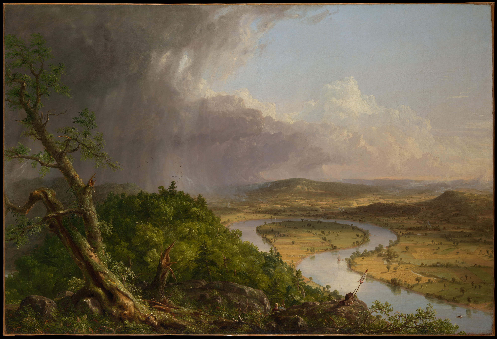

# 每日信息输入

<!-- id: sec-001 -->

## 科技与游戏事件

<!-- id: art-001 -->

### 馆藏记录怎样进入一期日报

体裁：新闻摘要

来源说明：出版引擎联调示例 · [大都会艺术博物馆藏品记录](https://www.metmuseum.org/art/collection/search/10497)

一条馆藏记录同时给出了题名、作者、年代和作品图片。本期用同一件作品检验两个阅读动作：先从目录找到文章，再断网查看画面。

<!-- id: sec-002 -->

## 每日好图

<!-- id: art-002 -->

### 《牛轭湖》里的两种天气

体裁：讲解综述

来源说明：[大都会艺术博物馆 · Thomas Cole，《牛轭湖》](https://www.metmuseum.org/art/collection/search/10497)，1836 年，馆藏号 08.228。

先看河谷的明暗分界。左侧的树木和乌云占住前景，右侧的河湾与农田在阳光下向远处展开。

<!-- id: mat-001 -->

图注：沿着河湾的弧线从近景向远景看，可以看见风暴与晴空在同一画面中交会。

材料出处：Thomas Cole，1836，大都会艺术博物馆（Gift of Mrs. Russell Sage, 1908），Open Access / CC0。[查看馆藏原作](https://www.metmuseum.org/art/collection/search/10497)

#### 回到前景

把视线从河湾移回左侧，近处的树干和斜坡把风暴带到了观看者身边。
